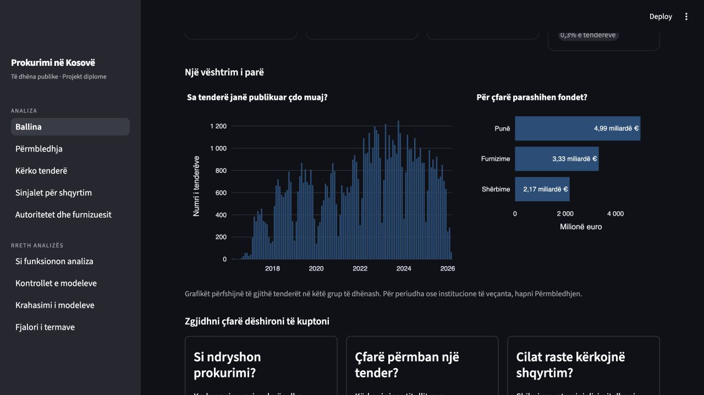
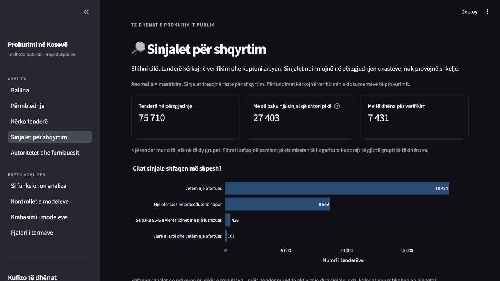

# Analiza e prokurimit publik në Kosovë

Projekt diplome për përpunimin e të dhënave të prokurimit publik, paraqitjen e
tyre në një panel në shqip dhe identifikimin e tenderëve që meritojnë shqyrtim
më të hollësishëm. Projekti lidh një proces të riprodhueshëm të përpunimit të të
dhënave me rregulla të shpjegueshme, krahasim modelesh dhe grafikë ndërveprues.

Paneli përdor një **kopje statike të të dhënave**, me rezultatet dhe modelet e
përfshira në këtë depo. Mund ta hapni pa shkarkuar të dhëna të reja dhe pa
i ritrajnuar modelet.

**Pikët e anomalive ndihmojnë në përzgjedhjen e rasteve për shqyrtim; ato nuk
janë prova të mashtrimit ose të shkeljeve.** Vlerësimi i modeleve mat pajtimin me
rregullat e projektit. Saktësia kundrejt rezultateve të verifikuara nga shqyrtues
njerëzorë ende nuk është përcaktuar.

## Çfarë përmban

- **Panel me nëntë faqe në shqip:** ballinë, përmbledhje, kërkim tenderësh,
  sinjale për shqyrtim, autoritete dhe furnizues, si funksionon analiza,
  kontrolle të modeleve, krahasim i modeleve dhe fjalor i termave.
- **Përpunim nga burimi te analiza:** ruajtje e burimit, pastrim, tabela analitike
  dhe kontrolle të cilësisë së të dhënave.
- **Analizë e shpjegueshme:** 15 rregulla të dukshme, prej të cilave katër kanë
  peshë në pikët e rregullave; krahasim i 35 konfigurimeve të modeleve dhe
  shpjegim i përbërësve të pikëve për secilin tender.
- **Gjurmueshmëri:** skedarët e publikimit lidhin rezultatet me të dhënat,
  kodin, konfigurimin dhe mjedisin që i kanë prodhuar.

## Pamje nga paneli

Ecuria mujore dhe vlerat e parashikuara sipas kategorisë:



Sinjalet që ndihmojnë në përzgjedhjen e rasteve për shqyrtim:



[Të gjitha pamjet dhe përshkrimet e tyre](docs/screenshots/README.md).

## Të dhënat e përfshira

Burimi është [Publikimi 115 i Open Contracting Partnership](https://data.open-contracting.org/en/publication/115),
me të dhëna të KRPP-së në formatin OCDS.

| Treguesi | Kopja e përfshirë |
|---|---:|
| Regjistrime të procedurave të prokurimit | 75 710 |
| Periudha e datave të publikimit | Mars 2016 – mars 2026 |
| Muaj me të dhëna / muaj në interval | 118 / 121 |
| Identifikues të njohur të autoriteteve kontraktuese | 205 |
| Mostra për shqyrtim manual | 150 tenderë, ende pa etiketa të plotësuara |

Ky mbulim nuk dëshmon se janë përfshirë të gjitha prokurimet në Kosovë.
Objektet `award` përfaqësojnë **vendime të regjistruara për dhënie të kontratës**;
vlerat e tyre nuk vërtetojnë nënshkrimin, zbatimin ose pagesën e kontratave.
Shifrat e hollësishme dhe kufizimet gjenden te [gjetjet](docs/findings.md)
dhe [metodologjia](docs/methodology.md).

## Hapja e panelit

Nevojiten Git dhe [uv](https://docs.astral.sh/uv/getting-started/installation/).
Depoja është publike dhe mund të klonohet pa llogari në GitHub. Komandat më
poshtë përdorin Python 3.11; `uv` e siguron nëse mungon. Paketa mbështet Python 3.9–3.12.

```bash
git clone https://github.com/YlldritQ/thesis.git
cd thesis
uv sync --frozen --python 3.11
gzip -dk data/raw/kosovo_ocds.jsonl.gz
uv run --no-sync python -m thesis ui --headless
```

Hapni **[http://localhost:8501](http://localhost:8501)**. Ndaleni panelin me
`Ctrl+C`. Për hapjet e ardhshme mjafton komanda e fundit, nga dosja e projektit.

Komanda `gzip` nevojitet vetëm kur `data/raw/kosovo_ocds.jsonl` mungon. Ajo
rikthen saktësisht të dhënat burimore nga arkivi i përfshirë dhe e ruan arkivin.
Skedari i zgjeruar përjashtohet nga Git për shkak të madhësisë.

Nëse projekti është tashmë i instaluar në `.venv`, mund ta nisni drejtpërdrejt:

```bash
.venv/bin/python -m thesis ui --headless
```

Hapja e parë mund të zgjasë, sepse aplikacioni kontrollon integritetin e skedarëve.
Për Docker, instalim për zhvillim dhe zgjidhje problemesh, shihni
[udhëzuesin e ekzekutimit dhe mirëmbajtjes](docs/operations.md).

## Si të filloni analizën

1. Hapni faqen **Përmbledhja** dhe zgjidhni periudhën, kategorinë ose autoritetin që
   ju intereson. Grafikët dhe treguesit në këtë faqe ndjekin filtrat.
2. Te **Kërko tenderë**, gjeni një tender dhe hapni hollësitë e tij.
3. Te **Sinjalet për shqyrtim**, lexoni arsyet e sinjalizimit dhe të dhënat që
   mungojnë para se të interpretoni pikët.
4. Përdorni **Autoritetet dhe furnizuesit** për krahasime të përmbledhura dhe
   **Fjalori i termave** për kuptimin e termave. Kontrolloni gjithmonë periudhën
   dhe bazën e krahasimit të shënuara në faqe.

[Udhëzuesi i përdorimit](docs/user_guide.md) shpjegon faqet, filtrat dhe mënyrën
e leximit të grafikëve, me shembuj dhe kufizimet përkatëse.

## Si është ndërtuar

```text
Burimi OCDS → bronze → silver → gold / veçoritë e tenderëve
                                            ↓
                                    krahasimi i modeleve
                                            ↓
                                   pikëzimi dhe shpjegimet
                                            ↓
                                      paneli Streamlit
```

| Dosja ose skedari | Përmbajtja |
|---|---|
| `src/thesis/` | Përpunimi, kontratat e të dhënave, rregullat, modelet dhe komandat |
| `streamlit_app/` | Faqet e panelit, grafikët dhe shpjegimet në shqip |
| `data/` | Burimi i kompresuar, rezultatet, modelet dhe dëshmitë e publikimit |
| `tests/` | Testet e njësive, kontratave, integrimit dhe faqeve |
| `docs/` | Udhëzuesit, metodologjia, arkitektura dhe raportet |
| `notebooks/` | Analiza eksploruese dhe shqyrtimi i cilësisë së të dhënave |
| `airflow_dags/` | Shembull opsional i orkestrimit të përpunimit |
| `uv.lock` | Varësitë e fiksuara për instalim; përdoret edhe në CI dhe Docker |
| `requirements-lock.txt` | Regjistrimi i mjedisit të përdorur për publikimin e audituar |

Të dhënat dhe modelet kanë skedarë shoqërues që kontrollohen së bashku.
[Udhëzuesi i të dhënave](data/README.md) shpjegon çfarë duhet ruajtur dhe çfarë
mund të rigjenerohet. `make clean` heq vetëm skedarët e përkohshëm të zhvillimit.

## Zhvillimi dhe rindërtimi

[CONTRIBUTING.md](CONTRIBUTING.md) përmban instalimin për zhvillim dhe komandat e
testimit. [Udhëzuesi i ekzekutimit dhe mirëmbajtjes](docs/operations.md) shpjegon
veçmas hapjen e rezultateve ekzistuese dhe krijimin e një publikimi të ri.

**Mos e nisni `pipeline run` vetëm për të hapur panelin.** Kjo komandë kontrollon
burimin në internet dhe mund të shkarkojë të dhëna të reja e të rindërtojë
rezultatet. Rindërtimi i plotë përfshin krahasimin dhe trajnimin e modeleve.
Ndryshimet në kodin e përpunimit ose në varësi kërkojnë një publikim të ri;
kontrollet e riprodhueshmërisë e dallojnë këtë nga shikimi i rezultateve në një
mjedis tjetër të përputhshëm.

## Dokumentacioni

Nisni nga [indeksi i dokumentacionit](docs/README.md). Dokumentet kryesore janë:

- [Udhëzuesi i përdorimit](docs/user_guide.md) — përdorimi dhe interpretimi i panelit.
- [Metodologjia](docs/methodology.md) — burimi, treguesit, modelet dhe kufizimet.
- [Arkitektura](docs/architecture.md) — rrjedha dhe kontratat e publikimit.
- [Shpjegimi i pikëve](docs/explainability.md) — formulat dhe një shembull i verifikuar.
- [Udhëzuesi i ekzekutimit dhe mirëmbajtjes](docs/operations.md) — instalimi, rindërtimi dhe problemet e zakonshme.
- [Gjetjet e gjeneruara](docs/findings.md) — shifrat e lidhura me publikimin e përfshirë.
- [Rishikimi i projektit](docs/project_review_2026_09.md) — kontrollet e kryera dhe çështjet e mbetura.
- [Protokolli i shqyrtimit manual](docs/manual_audit_protocol.md) — hapat për vlerësimin e pavarur.
- [Përdorimi i përgjegjshëm](docs/responsible_use.md) — interpretimi dhe komunikimi i rezultateve.

## Licenca

Kodi shpërndahet sipas [licencës MIT](LICENSE). Burimi i të dhënave dhe referencat
përkatëse dokumentohen te [metodologjia](docs/methodology.md).
