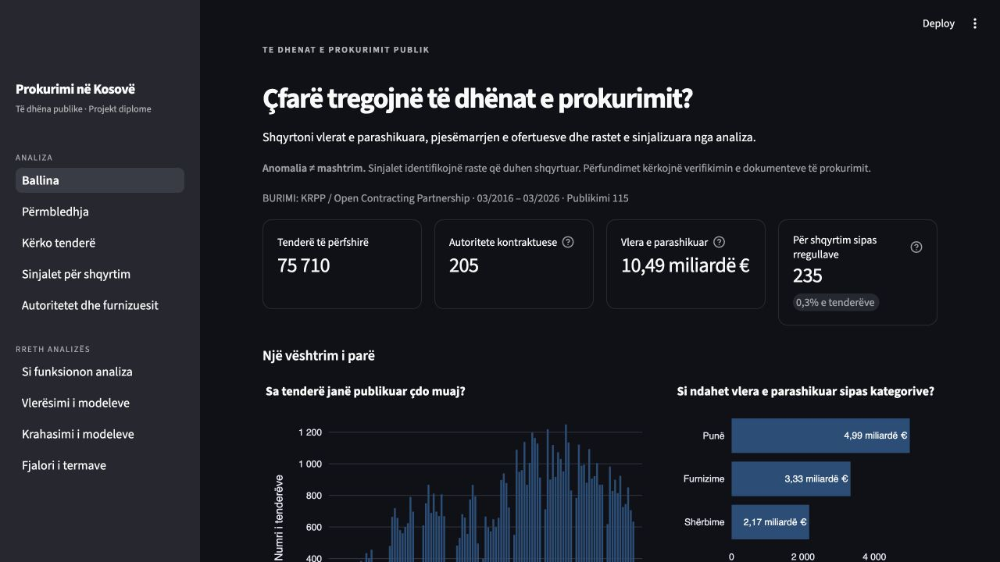
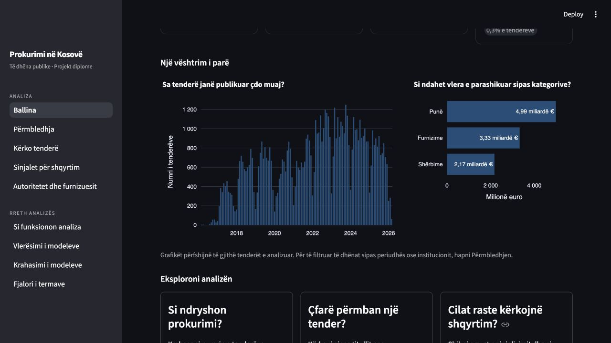
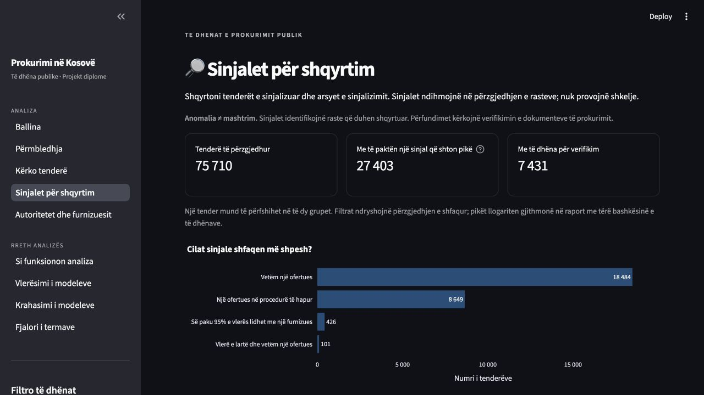
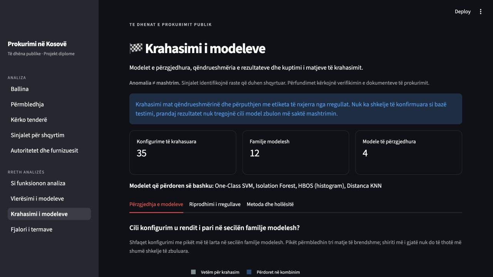

# Pamje të projektit për prezantim

Pamjet janë marrë drejtpërdrejt nga paneli më **5 nëntor 2026**, pas rishikimit
gjuhësor, me ndërfaqen në shqip dhe pa filtra të përzgjedhur. Ato përdorin kopjen statike të përfshirë
në depo: 75 710 procedura prokurimi, me data publikimi nga marsi 2016 deri në
mars 2026. Nuk paraqesin të dhëna të përditësuara në kohë reale.

Këto katër pamje paraqesin projektin në përgjithësi. Për prezantimin e një
rasti të veçantë, përdorni edhe pamjen e tenderit dhe shpjegimin e pikëve të tij.

| Skedari | Çfarë paraqet | Përshkrim për figurën |
|---|---|---|
| [01-ballina.jpg](01-ballina.jpg) | Ballinën dhe treguesit kryesorë | Ballina e panelit: numri i tenderëve, autoritetet kontraktuese, vlera e parashikuar dhe tenderët mbi pragun e rregullave. |
| [02-grafiket.jpg](02-grafiket.jpg) | Grafikët e ballinës | Numri mujor i tenderëve dhe shpërndarja e vlerës së parashikuar sipas kategorive të prokurimit. |
| [03-sinjalet.jpg](03-sinjalet.jpg) | Faqen e sinjaleve | Përmbledhja e tenderëve me sinjale që shtojnë pikë dhe shpeshtësia e secilit sinjal. I njëjti tender mund të ketë disa sinjale. |
| [04-modelet.jpg](04-modelet.jpg) | Faqen e krahasimit të modeleve | Përmbledhja e 35 konfigurimeve të krahasuara, 12 familjeve të modeleve dhe katër modeleve të përzgjedhura për kombinim. |

**Kufijtë e interpretimit:** vlera e parashikuar nuk është shpenzim i realizuar.
Sinjalet nuk provojnë shkelje; krahasimi i modeleve mat qëndrueshmërinë dhe
përputhjen me etiketa të nxjerra nga rregullat, jo saktësinë kundrejt rasteve
të verifikuara në mënyrë të pavarur.

## Pamjet

### Ballina

### Grafikët

### Sinjalet për shqyrtim

### Krahasimi i modeleve

